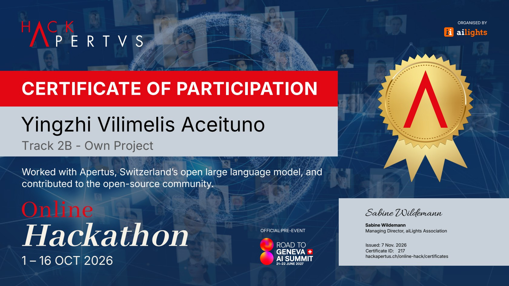

# Meditations RAG

Trouble at work? Anxious about the future? Struggling to come to terms with mortality? Stoic philosophy may give you peace of mind. This application selects the most fitting passages from Marcus Aurelius' *Meditations* in reply to your problem statement. Retrieval is powered by [Apertus](https://huggingface.co/swiss-ai) and measured against a
closed-model comparator (Claude Sonnet 5). It is a project built for [online Hack Apertus](https://hackapertus.ch/online-hack), Track 2B.

You describe what is disturbing your inner peace in your own words ("My coworker took all the credit for a successful project, and I missed a promotion as a result."); the tool returns the passages of Chrystal's 1902 translation that
fit best, cited by Book and §. It writes no advice of its own: what you read
is Marcus's text.

Apertus v1.5 70B does two jobs. It routes each message (a real problem, a
greeting, a question about the tool, an off-topic ask, a safety concern), and
it writes a short passage in Marcus's voice (HyDE) that is searched alongside
the message as typed, with the two rankings fused. On 20 validation queries, a
passage that a blind judge marked as unhelpful fills 48% of the top-two slots
with plain search and 22% with this pipeline; on 10 held-out queries, the
figures are 35% and 15%.

## Key results

Each setup retrieves from the same corpus and is scored on 20 hard validation
queries with two measures (details in the
[technical report](track_2b/technical_report.md), section 5):

- **recall@5** (higher is better): whether a gold passage reaches the top five.
- **dead@2** (lower is better): the share of the top-two passages that a
  blind judge marked as definitely not helping.

| Technique | recall@5 | dead@2 | p50 latency |
| --- | --- | --- | --- |
| Baseline: message as typed (`raw`) | 75% | 48% | 17 ms |
| **Ours: `raw+hyde`, Apertus v1.5 70B** | **80%** | **22%** | 1.4 s |
| `raw+hyde`, Claude Sonnet 5 | 75% | 28% | 2.8 s |
| `raw` + LLM rerank, Claude Sonnet 5 | 70% | 15% | 1.8 s |
| `raw` + LLM rerank, Apertus v1.5 70B | 65% | 35% | 1.0 s |
| `raw` + cross-encoder (MiniLM) | 55% | 52% | 58 ms |
| Hybrid BM25 + `raw` | 40% | 65% | 18 ms |

On 10 held-out test queries written after the design was fixed, dead@2 falls
from 35% (baseline) to 15% (ours), against 0% for Claude reranking.

- **Fusing HyDE with the original message is what pays off.** Every strategy
  that replaces the message lost to plain search on recall.
- **The open model holds up.** On `raw+hyde`, Apertus and Claude are within
  noise of each other.
- **Off-the-shelf rerankers and keyword search hurt**, because this corpus's
  gap between modern problems and Stoic text is conceptual, not lexical.
- **Caveat:** 20 validation and 10 test queries, one rater. Treat the
  differences as directional, not conclusive.

- **Technical report:** [track_2b/technical_report.md](track_2b/technical_report.md)
  ([PDF](track_2b/YingzhiVA_Report.pdf)): architecture, evaluation, limitations
- **Demo video:** [2 min](https://www.awesomescreenshot.com/video/57493731?key=af323515e7ccf222847f08decc760a63)

## Run it

Needs Docker. From the repository root:

```bash
cp track_2b/.env.example track_2b/.env   # then fill in LLM_API_KEY
make run                                  # http://localhost:7860
```

The root `Makefile` forwards to [track_2b/Makefile](track_2b/Makefile).
`LLM_NAME`, `LLM_BASE_URL` and `LLM_API_KEY` may also come from the shell. They
name any OpenAI-compatible endpoint serving Apertus; the defaults in
`.env.example` are CSCS's (Swiss National Supercomputing Centre), which served
every reported result. Without them the page still runs, in a reduced mode
(keyword routing, plain search).

| Command | What it does |
| --- | --- |
| `make run` | Build the image and serve the web UI |
| `make stop` | Stop the container |
| `make test` | Run the test suite inside the image |
| `make eval` | Reproduce the headline rows from the shipped completion cache, with no key and no LLM call |

The first build needs the network (PyPI, PyTorch CPU index, the bge-base
weights). After that the container needs only the LLM endpoint, and runs on
CPU in about two seconds a query.

## Sovereign deployment

- **Sovereign Swiss cloud (as measured):** Apertus served by CSCS in Lugano,
  under Swiss jurisdiction.
- **On-premise / air-gapped:** no code change. The embedder is baked into the
  image and the HuggingFace Hub is set offline, so point `LLM_BASE_URL` at an
  Apertus you serve yourself (any OpenAI-compatible server, e.g. vLLM).

## Layout

| Path | What it is |
| --- | --- |
| `track_2b/src/meditations_rag/` | The engine: ingest, index, route, retrieve, safety, render, web UI |
| `track_2b/src/eval/` | Evaluation harness (recall@5, blind dead@2) |
| `track_2b/src/tests/` | Tests |
| `track_2b/data/` | Corpus, index, evaluation sets and results, LLM completion cache (24 MB) |
| `track_2b/docs/` | Architecture diagram, build plan, report renderer |
| `track_2b/technical_report.md` | The report |

## Recognition

Certificate of participation from the organisers of the online Hack Apertus
(1–16 October 2026), Track 2B, Own Project.



## License

See [LICENSE](LICENSE). All Hack Apertus projects are open-sourced; see the
[Terms & Conditions](https://hackapertus.ch/terms-and-conditions) (6. What you
build is open source). The corpus is Project Gutenberg #55317 (public domain).
