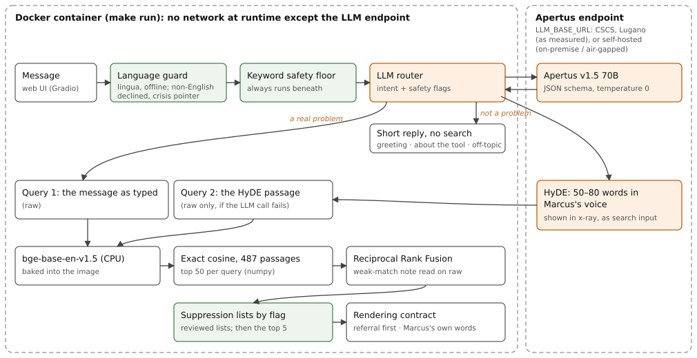

# Technical report — Meditations RAG

Passages from Marcus Aurelius' *Meditations* for what troubles you, retrieved
with Apertus and measured against a closed-model comparator.

- **Track:** Track 2B — Meditations RAG
- **Event:** Online
- **Team:** YingzhiVA (solo)
- **Demo:** [`link to video`](https://www.awesomescreenshot.com/video/57493731?key=af323515e7ccf222847f08decc760a63)

## 1. Summary

People describe their troubles in modern words ("my manager humiliates me in
meetings", "I'm afraid I was only promoted for diversity"); *Meditations*
answers in Stoic terms from the 2nd century. The gap between the two is
conceptual rather than lexical, so a plain semantic search often returns a
passage that shares words with the message and nothing else. Meditations
RAG retrieves the most fitting passages of George W. Chrystal's 1902
translation, cited by Book and §, and writes no advice of its own: what the
reader gets is Marcus's text. Apertus v1.5 70B does two jobs. It routes each
message (a real problem, a greeting, a question about the tool, an off-topic
ask, a safety concern), and it writes a short passage in Marcus's voice
(HyDE) that is searched alongside the message as typed; the two rankings are
fused. The measure that decided the design is **dead@2**: the share of the
top two passages a blind judge, this tool's author herself, strikes as definitely not helping. On the 20
validation queries, searching the message as typed puts a useless passage in
**48%** of the top-two slots; the shipped pipeline puts one in **22%**
(Fisher p ≈ 0.03), and recall@5 against gold labels rises from 75% to 80%.
On ten test queries written after every decision was made, the same
comparison reads **35% → 15%**. It runs in a CPU-only container in about two
seconds a query, and the only thing it needs at runtime is an Apertus
endpoint.

### Project timeline

Judges should know what predates the hackathon (1 October 2026). Before that
date: corpus ingestion and parsing, baseline retrieval with a command-line
interface, the evaluation harness with its labelled sets (the validation
labels come from one full read of the book by the author, which is extremely time consuming), and the first LLM routers,
built on the Apertus 2509 models (8B and 70B) with Claude Haiku as a
comparator. Everything that depends on Apertus v1.5, and the core part of the project, was done during the
hackathon: verifying which model CSCS and other providers actually serve,
every query strategy (rewriting, self-reflection, HyDE, multi-query, each
alone and fused), hybrid search and reranking, the blind dead@2 measure, the
held-out test set, the safety review, the web UI with x-ray, and this
packaging. The full history is public:
[github.com/YingzhiVA/meditations-rag](https://github.com/YingzhiVA/meditations-rag)

## 2. Architecture

Each message passes through five stages, all in one container except the
LLM calls:

1. **Language guard** (`route/language.py`, lingua, offline). The safety
   checks read English only, so a message that is not confidently English
   is declined with a crisis pointer before any model sees it.
2. **Routing** (`route/`). A keyword safety floor always runs; the Apertus
   router (JSON schema, temperature 0) adds the intent and its own safety
   flags. Flags only add: the union ships. Non-problems get a short reply
   and no search. Self-harm and medical emergencies get a referral and no
   passage.
3. **Retrieval** (`retrieve/`). Two queries, the message as typed and the
   HyDE passage, are embedded with bge-base-en-v1.5 on CPU, searched by
   exact cosine over all 487 passages (top 50 each), and fused by
   Reciprocal Rank Fusion. If the LLM call fails, the message alone is
   searched and the page says so.
4. **Post-retrieval safety** (`retrieve/safety.py`). Under a flag, reviewed
   lists withhold passages that read as counsel to endure abuse or as
   welcoming death; the reader sees how many were withheld, never which.
5. **Rendering** (`render.py`), shared by the web UI and the CLI: the
   referral first, an international helpline directory, a framing line
   under any flag, a note when the match is weak, then the passages in
   full.

The web UI (`web.py`) adds a side-by-side comparison with the plain
search and an always-on **x-ray** panel: routing, scores, every LLM call
(model, latency, tokens) and the HyDE passage Apertus wrote, labelled as
machine-written search input. Under any safety flag the HyDE text is not
shown, since nothing reviews it. LLM usage is rationed (a daily call cap, a
per-visitor hourly cap, a 2,000-character limit); past a cap, or after an
HTTP 401/403, the page degrades to keyword routing and plain search and
says when the limit resets.

### Target architecture

**(c) Sovereign Swiss cloud, as built and measured:** Apertus v1.5 70B is
served by CSCS, the Swiss National Supercomputing Centre in Lugano, under
Swiss jurisdiction; CSCS does not record prompts or responses. **(a)
On-premise and (b) air-gapped** need no code change: at runtime the
container needs only `LLM_BASE_URL` (the embedder is baked into the image
and the HuggingFace Hub is set offline; verified by running with the Hub
offline), so pointing it at an Apertus served inside the organisation (any
OpenAI-compatible server, e.g. vLLM) keeps messages in-house. The visitor's
browser may ask for the UI theme's web fonts, which fall back to system
fonts on a closed network.

| | Build time | Runtime |
|---|---|---|
| Python packages | PyPI, PyTorch CPU index | — |
| Embedding model | HuggingFace Hub (baked into the image) | — (Hub set offline) |
| Corpus, index | in `data/` | — |
| Apertus | — | `LLM_BASE_URL` (CSCS, or self-hosted) |

## 3. Use of Apertus

- **Model:** `swiss-ai/Apertus-v1.5-70B` (router and HyDE). Also evaluated:
  Apertus v1.5 8B, and the 2509 8B and 70B.
- **How it is used:** inference (classification and generation) and
  evaluation.
- **Where it runs:** CSCS's OpenAI-compatible endpoint; any endpoint given
  by `LLM_NAME`, `LLM_BASE_URL`, `LLM_API_KEY`.

Both calls use temperature 0, no thinking, a 30-second timeout and at most
1,024 output tokens. The router answers a JSON schema through
`response_format` (prompt `d83b622eb0`; every call in the reported runs came
back schema-valid). The HyDE prompt (`43e6eb9c68`) asks for "one short
passage in the manner of Marcus Aurelius' Meditations … three to five
sentences, about fifty to eighty words", treats the message as data, and
forbids counselling endurance of mistreatment or presenting death as
welcome. The client refuses an answer whose served model differs from the
one requested, so a substituted model becomes a visible fallback, never a
mislabelled row.

**Verifying the model before measuring it.** One provider's "v1.5" 8B
agreed with the 2509 8B on 65 of 66 greedy router answers, and its 70B id
was answered by a different model family in 16 of 102 requests; those ids
were never used. CSCS's v1.5 8B agreed with the 2509 8B on only 38 of 66,
and both CSCS models accepted a 100,276-token prompt, beyond the 2509
models' documented limits. Only then were v1.5 rows reported.

**Other models and their role.** bge-base-en-v1.5 (BAAI, open) embeds the
corpus and queries at runtime. Everything else is evaluation only and absent
from the shipped system: Claude Sonnet 5 and Haiku 4.5 (closed weights) are
the comparator, to show how the open model fares against a leading closed
one; Qwen3-235B-A22B-Instruct-2507 (open) was tried as an automatic judge,
missed the agreement gate set in advance (Cohen's κ 0.34 against ≥ 0.6),
and so scores nothing; two cross-encoders (ms-marco-MiniLM-L-6-v2,
bge-reranker-base, open) are evaluated reranking rows.

## 4. Data

- **Corpus:** Project Gutenberg #55317, *Meditations*, translated by George
  W. Chrystal (1902). Public domain. 12 books, 487 numbered sections; one §
  is one passage, and the parser asserts every per-book count.
- **Evaluation sets** (`data/eval/`), all written by the author, no
  personal data and no human subjects: 28 golden queries (20 validation, 6
  canaries, 2 questions about the book), 45 router cases, 27 safety cases,
  36 language cases, 10 test queries, and 570 blind verdicts.
- **Completion cache** (`data/cache/llm/`): every LLM completion the
  reported runs used, keyed by model and full prompt, so the numbers can be
  reproduced without a key.

All of it is in the repository (24 MB).

## 5. Evaluation

**Two measures.** *recall@5* scores whether one of a query's gold passages
(one curator, about 3.5 per query, hit-any) reaches the top five. It is a
lower bound, and it leans toward the plain search, since the labels were
picked while that was the only retriever. *dead@2* is free of that lean:
every passage that any configuration ranked first or second on a validation
query was judged by the author once, blind to configuration and rank (504 pairs), as
definitely not helping or not.

**Validation set** (20 hard queries; configurations were chosen on it):

| Setup | recall@5 | dead@2 | dead first passage | p50 latency |
|---|---|---|---|---|
| Baseline: message as typed (`raw`) | 75% | 48% (19/40) | 7/20 | 17 ms |
| **Ours: `raw+hyde`, Apertus v1.5 70B** | **80%** | **22% (9/40)** | 5/20 | 1.4 s |
| `raw+hyde`, Claude Sonnet 5 | 75% | 28% (11/40) | 4/20 | 2.8 s |
| `raw` + LLM rerank, Claude Sonnet 5 | 70% | 15% (6/40) | 2/20 | 1.8 s |
| `raw` + LLM rerank, Apertus v1.5 70B | 65% | 35% (14/40) | 5/20 | 1.0 s |
| `raw` + cross-encoder (MiniLM) | 55% | 52% (21/40) | 12/20 | 58 ms |
| Hybrid BM25 + `raw` | 40% | 65% (26/40) | 12/20 | 18 ms |

**Test set** (ten problem statements written after the choice, held out,
judged blind the same way; 53 pairs):

| Setup | dead@2 | dead first passage |
|---|---|---|
| Baseline: `raw` | 35% (7/20) | 4/10 |
| **Ours: `raw+hyde`, Apertus v1.5 70B** | **15% (3/20)** | **0/10** |
| `raw` + LLM rerank, Claude Sonnet 5 | 0% (0/20) | 0/10 |

**What the numbers say.**

- **Fusing with the message is what made HyDE pay.** Every strategy that
  replaces the message (rewriting, HyDE alone, multi-query) lost to the
  plain search on recall; HyDE fused with it was the only one to gain.
- **The open model holds on the hardest task.** HyDE is style imitation,
  where an open model was expected to trail; on `raw+hyde` Apertus and
  Claude are within noise (80% and 75% recall, 22% and 28% dead@2).
- **The result repeats on held-out queries.** Ten test queries cannot make
  the difference significant alone (p ≈ 0.27); the evidence is that order
  and size repeat. Per query, HyDE fixed five, broke two and tied three.
- **The comparator wins one column.** Claude reranking has the cleanest top
  two in both sets; it gives up recall, and its prompt is close to the
  judging rule, so it optimises nearly what dead@2 measures.
- **Off-the-shelf rerankers and keyword search hurt:** they reward topical
  and lexical overlap, and this corpus's gap is neither.

**Routing and safety** (`router_set`, `safety_set`):

| Router | out-of-scope caught, in-scope kept | safety flags, with floor | LLM alone | p50 |
|---|---|---|---|---|
| Keyword (baseline, fallback) | 0%, 100% | 18/20 | — | — |
| **Apertus v1.5 70B (shipped)** | **89%, 94%** | **20/20** | 8/20 | 0.3 s |
| Apertus v1.5 8B | 78%, 94% | 20/20 | 12/20 | 0.15 s |
| Claude Haiku 4.5 | 94%, 94% | 20/20 | 20/20 | 0.9 s |

The keyword floor is what makes an open router safe enough: alone, the 70B
catches 8 of 20 flags. On the test set the router kept all ten problems
in scope with no false flag.

**A check that failed.** The weak-match note fires below a cosine of 0.43,
a threshold read off the validation sets. On the test set it fired on a real
problem ("I've been looking for a job for half a year and all I ever get are
rejections", 0.416), below an off-topic question ("linked list", 0.419): no
score separates the two. It was not re-tuned on those numbers; the note was
reworded as a quality warning shown before the passages, never a refusal.

## 6. Limitations

- **Small n and one rater.** 20 validation and 10 test queries; a five-point
  move in recall@5 is one query. Gold labels and blind verdicts come from
  the same person, and the automatic judge did not reach the agreement gate.
- **English only.** Non-English messages are declined, since the safety
  floor cannot read them.
- **Live HyDE varies.** Apertus at temperature 0 words its passage slightly
  differently from call to call, so the top five can change between two
  identical queries; each reported number is one sample per query.
- **HyDE can invent.** For the promotion query it wrote about "the color of
  your skin", which the reader never mentioned. That is why x-ray labels it
  as search input and hides it under any flag.
- **Concentration.** A few passages fill many top-two slots across
  unrelated messages; a reader trying several will meet them again.
- **Routing misses.** "What does Marcus say about the afterlife?" is routed
  as a question about the tool; the LLM router alone misses most safety
  flags, which is why it never runs without the floor.

## 7. Reproducibility

From the root of `track_2b/`, on a clean checkout:

- `make run` builds the image and serves the page at `http://localhost:7860`.
  Set `LLM_NAME`, `LLM_BASE_URL` and `LLM_API_KEY` (shell or `.env`, see
  `.env.example`); without them the page runs in reduced mode.
- `make eval` reproduces the headline rows from the shipped completion
  cache, with no key and no LLM call: `raw` 75% / 48%, `raw+hyde` 80% / 22%.
- `make test` runs the 89 tests, including the rendering invariants (the
  referral leads and no withheld passage is named, for every flag set).

Versions are pinned in `constraints.txt` to those stamped in the index
(torch 2.14.0, sentence-transformers 6.0.1, numpy 2.5.3). The index was
built on a GPU; on the container's CPU build the plain search reproduces the
recorded top five on all 20 validation queries (largest cosine difference
0.00005). Hardware: an x86-64 machine; no GPU. Every LLM call is at
temperature 0. Code and data as measured: commit `cd2047f`.

## 8. Next steps

- **German, French and Italian**, through the LLM router and HyDE, with a
  safety floor that can read them.
- **A second rater** for the blind verdicts, and an LLM judge calibrated
  against them, so the evaluation can grow past one person's reading.
- **Measure HyDE's sample variance**, and serve a cached HyDE passage per
  message so repeat queries are stable.
- **Synthesis**: modern counsel grounded only in the retrieved passages,
  with citations and its own faithfulness evaluation.

## License

Creative Commons Attribution 4.0 (CC-BY-4.0). All HackApertus projects are open-sourced.

## References

1. M. Aurelius, *The Meditations of the Emperor Marcus Aurelius Antoninus*,
   tr. G. W. Chrystal (1902). Project Gutenberg #55317.
2. Swiss AI Initiative, *Apertus: Democratizing Open and Compliant LLMs for
   Global Language Environments* (2025); models at huggingface.co/swiss-ai.
3. L. Gao, X. Ma, J. Lin, J. Callan, *Precise Zero-Shot Dense Retrieval
   without Relevance Labels* (HyDE), ACL 2023.
4. G. V. Cormack, C. L. A. Clarke, S. Buettcher, *Reciprocal Rank Fusion
   Outperforms Condorcet and Individual Rank Learning Methods*, SIGIR 2009.
5. S. Xiao et al., *C-Pack: Packaged Resources to Advance General Chinese
   Embedding* (BGE), 2023.
